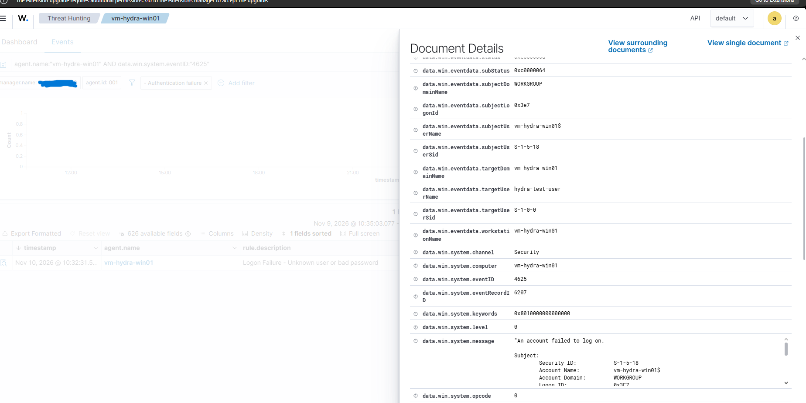
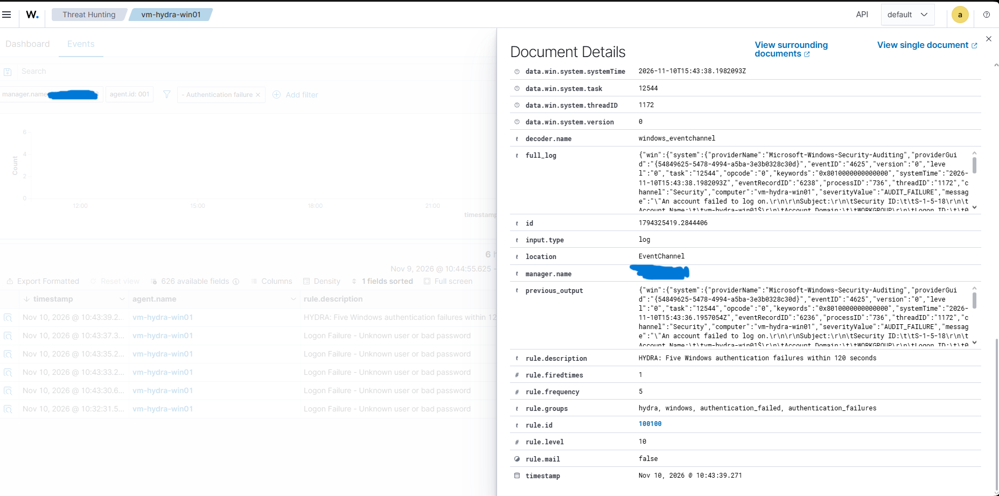

# HYDRA - Hybrid Cloud Security Operations Center

**Azure Windows Server | Wazuh SIEM | Ubuntu Linux | Tailscale | Detection Engineering**

## Overview

HYDRA is a hands-on hybrid-cloud security monitoring lab designed to demonstrate endpoint telemetry collection, centralized security monitoring, and custom detection engineering.

The project connects an Azure-hosted Windows Server 2022 endpoint to a locally hosted Wazuh SIEM through an encrypted Tailscale network.

I deployed the infrastructure, configured endpoint monitoring, investigated Windows authentication failures, and developed a custom correlation rule to identify repeated failed login attempts.

## Architecture

**Azure Cloud**
- Windows Server 2022 virtual machine (`vm-hydra-win01`)
- Wazuh endpoint agent
- Windows Security Event Logs

**Private Connectivity**
- Tailscale encrypted mesh networking
- Agent communication over TCP 1514
- Agent enrollment over TCP 1515
- No public inbound RDP access required

**Local Infrastructure**
- Ubuntu Linux virtual machine hosted in VirtualBox
- Wazuh Manager
- Wazuh Indexer
- Wazuh Dashboard

**Data flow:**

Azure Windows Server → Tailscale → Ubuntu Wazuh Manager → Wazuh Indexer → Wazuh Dashboard

## Detection Engineering

### Detection 001 — Windows Authentication Failure

**Windows Event ID:** 4625  
**Wazuh Rule ID:** 60122  
**Severity:** Level 5

Generated a controlled failed authentication attempt against a nonexistent local Windows account.

Verified that Windows recorded Event ID 4625 and that Wazuh successfully ingested and classified the event.

### Detection 002 — Repeated Authentication Failures

**Custom Rule ID:** 100100  
**Severity:** Level 10  
**Threshold:** 5 matching failures within 120 seconds

Created and validated a custom Wazuh correlation rule based on existing Windows authentication failure rule 60122.

Executed five controlled failed authentication attempts and confirmed that the custom detection generated a Level 10 alert.

**Detection logic:** [View custom Wazuh rule](hydra-auth-failures.xml)

## Validation Results

| Test | Expected Result | Actual Result |
|---|---|---|
| Azure-to-Wazuh connectivity | TCP 1514/1515 reachable | Passed |
| Endpoint enrollment | Windows agent active | Passed |
| Single failed login | Event ID 4625 detected | Passed |
| Standard authentication alert | Wazuh rule 60122 triggered | Passed |
| Repeated failed logins | Custom rule 100100 triggered | Passed |


## Detection Evidence

### Detection 001 — Windows Authentication Failure

A controlled failed login on Azure Windows Server generated
Security Event ID 4625 and triggered Wazuh rule 60122.



### Detection 002 — Custom Authentication Correlation

Five failed authentication attempts triggered custom Wazuh
rule 100100, generating a Level 10 security alert.




## System Architecture


```mermaid
flowchart TB
    subgraph AZ["Microsoft Azure — West US 2"]
        WIN["Windows Server 2022<br/>vm-hydra-win01"]
        LOG["Windows Security Event Logs<br/>Event ID 4625"]
        AGENT["Wazuh Windows Agent"]

        WIN --> LOG
        LOG --> AGENT
    end

    subgraph NET["Private Network — Tailscale"]
        TS["Encrypted Tailscale Connection<br/>TCP 1514: Agent Events<br/>TCP 1515: Enrollment"]
    end

    subgraph LOCAL["Local Infrastructure — VirtualBox"]
        subgraph UB["Ubuntu Linux VM"]
            MGR["Wazuh Manager<br/>Event Collection and Analysis"]
            RULE["Detection Engineering<br/>Rule 60122: Failed Login<br/>Rule 100100: 5 Failures / 120s"]
            IDX["Wazuh Indexer<br/>Alert Storage"]
            DASH["Wazuh Dashboard<br/>Threat Hunting and Investigation"]

            MGR --> RULE
            RULE --> IDX
            IDX --> DASH
        end
    end

    AGENT --> TS
    TS --> MGR

    ANALYST["Security Analyst<br/>Windows Browser"]
    ANALYST <-->|"HTTPS over Tailscale"| DASH

    classDef azure fill:#e8f2ff,stroke:#3273c8,color:#173b70
    classDef network fill:#f0e9ff,stroke:#8256c7,color:#442675
    classDef security fill:#e5f5ed,stroke:#23865b,color:#14543a
    classDef analyst fill:#fff0df,stroke:#c88a36,color:#70420d

    class WIN,LOG,AGENT azure
    class TS network
    class MGR,RULE,IDX,DASH security
    class ANALYST analyst
## Security Considerations

- Restricted public inbound access to the Azure Windows virtual machine.
- Used Tailscale for private connectivity between cloud and local infrastructure.
- Used controlled authentication tests rather than targeting real user accounts.
- Avoided publishing passwords, authentication keys, and administrative credentials.

## Limitations and Future Improvements

The custom rule counts matching authentication failures within a specified time window. It does not currently correlate attempts by individual username or source IP.

Planned improvements include source-aware correlation, additional Windows detection rules, alert tuning, and broader endpoint monitoring.

## Skills Demonstrated

- Security Information and Event Management (SIEM)
- Windows Event Log analysis
- Detection engineering and alert correlation
- Microsoft Azure virtual machines
- Linux server administration
- Secure hybrid-cloud networking
- Security validation and troubleshooting
